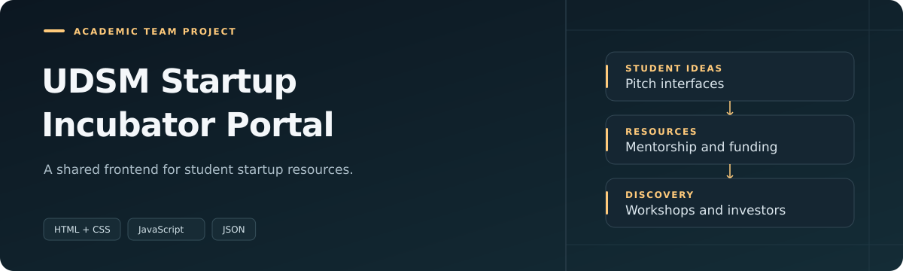

  

[Professional portfolio](https://johnportifolio.rjaybarber.shop)

An academic team project presenting startup resources for students. I served as project lead and developed the homepage.

### My contribution

| Area | Contribution |
| :--- | :--- |
| Team leadership | Coordinated an academic frontend project. |
| Frontend development | Developed the homepage. |
| Collaboration | Worked with the team through a shared Git workflow. |

**Scope:** academic frontend prototype.

---

[Ruhumbika Mtumba John](https://github.com/Ruhumbika) · Software Engineer
